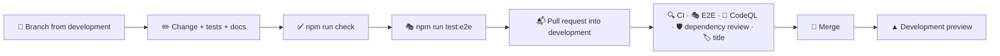

# 🤝 Contributing

## 🔄 Workflow



1. 🌿 Create a branch from `development`, named after the change: `feat/player-heatmap`, `fix/compare-swap`.
2. ✅ Make your changes, add tests and run `npm run check`.
3. 🎭 For anything visitors see, run `npm run test:e2e` as well: it covers redirects, accessibility, phones and the Lighthouse budget.
4. 📝 Describe a user-visible change in one line under **Unreleased** in `CHANGELOG.md`.
5. 📬 Open a pull request into `development` and fill in the checklist from the template.
6. 🔀 Merge once everything is green. `development` reaches `staging` and `main` through the release flow in [Releases](./releases.md).

> [!TIP]
> `make setup` turns on the Git hooks in `.githooks/` (or run `git config core.hooksPath .githooks`). Before every commit they check the formatting and lint the staged files and look for em and en dashes; the message hook rejects messages that do not follow [Conventional Commits](#-commit-messages).

Bugs and ideas go through the issue forms in `.github/ISSUE_TEMPLATE`; security problems are reported privately as described in the [security policy](../.github/SECURITY.md).

## 🧹 Code style

Formatting and linting are automated, so reviews can focus on behaviour.

- 🎨 **Oxfmt** formats TypeScript, SCSS, JSON, YAML and Markdown with a print width of 120 and sorts imports. Run `npm run format`.
- 🧹 **Oxlint** enables the `correctness`, `suspicious` and `perf` categories with type-aware TypeScript rules, React hooks and React Compiler rules, the Next.js, `jsx-a11y`, `import`, `unicorn` and `vitest` plugins and the layer rules. Run `npm run lint`.
- 🔷 **TypeScript** runs in strict mode with `noUncheckedIndexedAccess`, `verbatimModuleSyntax` and `erasableSyntaxOnly`.
- 🧾 **No em or en dashes** in code, docs or texts: `npm run lint:text`, part of `npm run check` and CI, points to each one. Use a comma, a colon or a hyphen instead.
- 🔗 **Shared files stay identical.** The Git hooks, the scripts in `scripts/` that all three apps use, the comment plugin and the editor and Dependabot settings are the same in tasks, weather and faceit-stats; `make shared` compares them when the other apps are checked out next to this one, `make shared-sync` copies the files of the app you changed over the other two, and the weekly **Shared files** workflow checks out the other two repositories and runs the same comparison.

### 💬 Comments

Names, small functions and types carry the intent, and every function, component, hook and effect, and every block that is not obvious, gets one short line above it that says what it does:

```ts
// Drops later entries that describe an item already in the list
const unique = <Item>(items: readonly Item[], isSame: (a: Item, b: Item) => boolean) =>
```

> [!IMPORTANT]
> A custom Oxlint plugin in `lint/comments.js` (`local/short-comments`) reports comments longer than one line or 80 characters, comments at the end of a line of code and every lint, type or coverage directive (`eslint-disable`, `@ts-expect-error`, `istanbul ignore` and the like). Its second rule, `local/require-comments`, reports every function declaration and every variable holding a function without a comment line right above it.

Styles, configuration, Dockerfiles and workflows follow the same convention: mixins, keyframes, media and container queries and theme blocks carry a line too. Lists such as `.gitignore`, `.dockerignore` and the Oxlint overrides are split into groups, each with a one-line heading, and `tsconfig.json` groups its options the same way. Test helpers get a line like any other function. Anything that needs more than a line belongs in `docs/`.

### 🧭 Where code goes

| You are adding…                     | Put it in                                                                 |
| ----------------------------------- | ------------------------------------------------------------------------- |
| A FACEIT endpoint                   | `src/shared/api/faceit.ts`                                                |
| A field from a FACEIT response      | `src/features/squad/api/parse.ts` and `src/features/squad/model/types.ts` |
| A statistic or rule about players   | A pure function in `src/features/squad/model/`                            |
| A section of the squad overview     | `src/features/dashboard/ui/`                                              |
| A section of the player page        | `src/features/player/ui/`                                                 |
| A section of the compare page       | `src/features/compare/ui/`                                                |
| Something every page shows          | `src/features/squad/ui/`                                                  |
| Metadata, structured data, a card   | `src/features/seo/`                                                       |
| Part of the header or footer        | `src/widgets/Header/` or `src/widgets/Footer/`                            |
| A building block without squad data | `src/shared/ui/`                                                          |
| A formatter or a generic helper     | `src/shared/lib/`                                                         |
| Browser state                       | A hook in `src/shared/hooks/`, or in a feature's `model/`                 |
| A text                              | Every catalog in `src/shared/i18n/messages/`                              |
| A language                          | See [Localization](./i18n.md#-adding-a-language)                          |
| A browser scenario                  | `e2e/*.spec.ts`, with data in `e2e/faceit-api.ts`                         |

> [!WARNING]
> `shared` must not import from `features`, `widgets` or `app`, and `features` must not import from `widgets` or `app`. Oxlint fails the build otherwise; move the code down a layer or pass the data in as props.

### 📐 Conventions

| Topic            | Convention                                                                                                                                                                                                                          |
| ---------------- | ----------------------------------------------------------------------------------------------------------------------------------------------------------------------------------------------------------------------------------- |
| 🧩 Components    | One folder per component: `Name/Name.tsx` and `Name.module.scss`, arrow functions, default export; `"use client"` only where hooks or events are needed                                                                             |
| 🧮 Logic         | Pure functions in a `model/` or `lib/` folder that take plain data and return plain data, tested next to them                                                                                                                       |
| 🎨 Styles        | CSS Modules with the tokens from `_tokens.scss` (`var(--surface)`, `var(--ink-muted)`) and the mixins from `_mixins.scss` (`panel`, `text()`, `from()`, `hover`, `reduced`); raw colours only for levels, medals and the brand mark |
| 🖍️ Data marks    | Bars and legend swatches carry the global `mark`, `mark-muted` or `mark-line` class, so they stay visible in forced colours mode; selectable options style their own forced colours                                                 |
| ✍️ Text          | Every UI text in all ten catalogs, never in a component; no em or en dashes, use commas, colons or plain hyphens such as `12-8`; gaming terms such as ELO, K/D and ADR stay in English                                              |
| ♿ Accessibility | Native elements first, a label for every control, colour never alone                                                                                                                                                                |
| 📥 Imports       | The `@/` alias for anything outside the current folder, relative paths inside it                                                                                                                                                    |
| 🧪 Tests         | Next to the code as `*.test.ts(x)`; query by role and accessible name                                                                                                                                                               |

## ➕ Adding a metric

1. 🧪 Parse the field in `parseMatch()` and add it to `Match` in `src/features/squad/model/types.ts`.
2. 🧮 Average or total it in `summarize()` in `src/features/squad/model/stats.ts`.
3. 🏷️ Add a definition to `METRICS` in `src/features/squad/model/metrics.ts` with the message keys of its short label and name, the digits and whether it is a percentage, and add both texts to every catalog.
4. 📋 Add its key to `METRIC_KEYS` or `MATCH_METRIC_KEYS`; the leaderboard, rankings, trends and form tiles pick it up.
5. ✅ Extend the parser and statistics tests.

## 📸 README pictures

`scripts/screenshots.mjs` takes every picture in `docs/images` from a running server. The README shows the real squad, so serve the production build with your own `.env` and run the script:

```bash
make build
make start        # in another terminal
make screenshots  # node scripts/screenshots.mjs http://localhost:3000
```

Against the mock API the same script shows the four test players. It finds the best player of the squad by itself, so it works with any squad.

## 📝 Commit messages

Commits follow [Conventional Commits](https://www.conventionalcommits.org/):

```text
feat(player): add a map filter to the match history
fix(faceit): retry when the API answers 503
style: refine the leaderboard medals
docs: describe the caching profiles
chore(deps): update dependencies
```

| Type          | Use it for                                      |
| ------------- | ----------------------------------------------- |
| ✨ `feat`     | A new feature                                   |
| 🐛 `fix`      | A bug fix                                       |
| ♻️ `refactor` | Code changes without new behaviour              |
| 💄 `style`    | Visual and styling changes                      |
| ✅ `test`     | Adding or updating tests                        |
| 📝 `docs`     | Documentation                                   |
| 👷 `ci`       | Pipeline and automation                         |
| ⚡ `perf`     | A faster or lighter app without new behaviour   |
| 📦 `build`    | The build, Docker images and build dependencies |
| 🔧 `chore`    | Dependencies and maintenance                    |
| ⏪ `revert`   | Reverting an earlier commit                     |

The `commit-msg` hook checks every message, and `.github/workflows/pr-title.yml` checks the title of every pull request, because a squash merge turns the title into the commit message.
