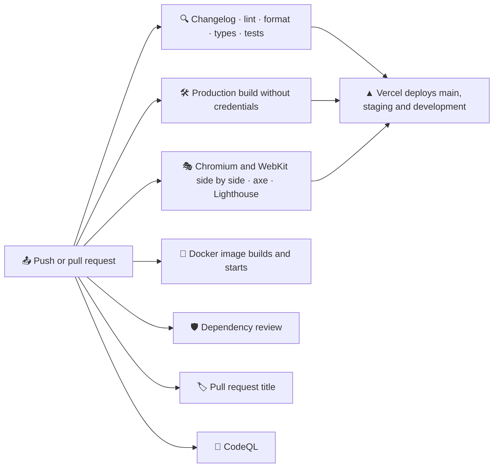

# 🚀 Deployment

FACEIT Stats is a regular Next.js server: it needs Node.js, `FACEIT_API_KEY` and `FACEIT_PLAYERS` both for the build and at run time, and `SITE_URL` on a custom domain. There is no database.

## 🔁 Pipeline

CI runs on pushes to `main`, `staging` and `development`, on pull requests into them and on demand. Version tags start the release workflow described in [Releases](./releases.md).



| Job                  | Workflow          | What it does                                                                                                                                                                                                                                                            |
| -------------------- | ----------------- | ----------------------------------------------------------------------------------------------------------------------------------------------------------------------------------------------------------------------------------------------------------------------- |
| 🔍 Verify            | `ci.yml`          | Install, registry signatures, a changelog section for the current version, Oxlint, no em or en dashes, Oxfmt, types, unit tests with coverage, a coverage summary and the HTML report                                                                                   |
| 🛠️ Build             | `ci.yml`          | `next build` without FACEIT credentials, then `scripts/build-report.mjs` checks every language, the 404 page, sitemap, robots, icons and security headers and reports the bundle size                                                                                   |
| 🎭 E2E               | `ci.yml`          | Two parallel jobs, each with its browser from a cache keyed by the Playwright version, build against the mock FACEIT API: Chromium on desktop and phone with the Lighthouse budget, and WebKit. Axe, forced colours and reflow run in both, and each uploads its report |
| 🐳 Docker            | `ci.yml`          | Builds the staging image with Buildx and a layer cache in GitHub Actions from `docker/Dockerfile` without credentials, starts it and waits until `/healthz` answers                                                                                                     |
| 🏷️ PR title          | `pr-title.yml`    | Pull requests fail when the title does not follow Conventional Commits, so a squash merge keeps the history readable                                                                                                                                                    |
| 🛡️ Dependency review | `ci.yml`          | Pull requests fail on new dependencies with high-severity advisories                                                                                                                                                                                                    |
| 🔬 CodeQL            | `codeql.yml`      | `security-extended` queries for TypeScript and the workflows on every change and every Monday                                                                                                                                                                           |
| 🔗 Shared files      | `shared.yml`      | On Mondays and by hand: checks out tasks, weather and finance and compares the files the four apps share                                                                                                                                                                |
| 📸 Screenshots       | `screenshots.yml` | By hand: takes the screenshots of the visual tests on Linux and uploads them for a commit, see [Testing](./testing.md#-visual-tests)                                                                                                                                    |
| 📡 Monitor           | `monitor.yml`     | Checks the live site and its Lighthouse scores once `MONITOR_URL` is set, see [Monitoring](#-monitoring)                                                                                                                                                                |
| 🏷️ Release           | `release.yml`     | On a `v*.*.*` tag: checks that the tag matches `package.json` and sits on `main`, then publishes the GitHub release with the notes from `CHANGELOG.md` and the Docker image to GitHub Packages                                                                          |

The build job proves that the app builds without secrets: with no key, every page prerenders the setup screen.

- 🗃️ The build and both end-to-end jobs keep `.next/cache/turbopack` between runs with `actions/cache`, keyed by the lockfile and the sources, so a build only recompiles what changed. The fetch cache is left out, so a build never reuses old API answers.

## ⚙️ One-time GitHub setup

1. Open **Settings → Code security** and enable **Private vulnerability reporting**, **Dependabot alerts** and **Code scanning** (CodeQL uploads its results there).
2. Create `development` and `staging`, make `development` the default branch and protect `main` and `staging` as described in [Releases](./releases.md#️-one-time-github-setup).
3. After the first deployment, add the repository variable `MONITOR_URL` with the address of the live site, `https://stats.sacrificed.me`, under **Settings → Secrets and variables → Actions → Variables** to turn on the [monitor](#-monitoring).

> [!TIP]
> The `e2e` job never needs a real API key: the mock server answers every request, so forks and Dependabot pull requests run the full suite too.

## ☁️ Hosting

### ▲ Vercel

1. 📥 Import the repository in Vercel. The framework preset **Next.js** needs no changes.
2. 🔑 Add the environment variables for **Production** and **Preview**:

   | Variable         | Value                                      |
   | ---------------- | ------------------------------------------ |
   | `FACEIT_API_KEY` | The server-side key                        |
   | `FACEIT_PLAYERS` | The squad, for example `sacrificed,Nitron` |
   | `SITE_URL`       | Not needed on Vercel, see below            |

3. 🚀 Deploy. `main` is the production branch; `staging`, `development` and every pull request get preview deployments, see [Environments](./releases.md#️-environments).

4. 🌐 Add `stats.sacrificed.me` under **Settings → Domains** and create the DNS record Vercel shows for it. Optionally let the `vercel.app` address redirect to the domain.

Without `SITE_URL` the address comes from `VERCEL_PROJECT_PRODUCTION_URL`, which Vercel sets to the custom domain once it is added, so canonical links, the sitemap and Open Graph cards follow it without a variable. `SITE_URL` is for Docker and other hosts, or to force another address.

> [!NOTE]
> `vercel.json` runs the server functions in `fra1` (Frankfurt), close to the visitors in Europe. Without it a new project runs them in `iad1` (Washington, D.C.), and every page that is not cached yet pays for a trip across the Atlantic. Pick another [region](https://vercel.com/docs/regions) there if most visitors live elsewhere.

> [!IMPORTANT]
> Vercel takes the Node.js version from `engines.node` in `package.json`. `>=24` lets it build with the newest major it supports, 24 today, and move to 26 on its own once Vercel offers it. A range that only allows a newer line than Vercel supports, such as `>=26`, fails the build with "invalid or discontinued Node.js Version".

> [!NOTE]
> Preview deployments are kept out of search engines automatically: robots disallow everything and pages are marked `noindex`.

> [!WARNING]
> Changing an environment variable on Vercel needs a new deployment, because the player pages are prerendered from the squad at build time.

All ten languages are part of every deployment; there is nothing to configure. The proxy that picks the language runs on the Node.js runtime next to the pages.

### 🐳 Docker

The shared service lives in `compose.yaml` at the root, and everything else in `docker/`: one multi-stage `Dockerfile` and an overlay per environment. `.dockerignore` keeps `node_modules`, build output, docs and every `.env*` file out of the build context.

| File                      | What it adds                                                                                |
| ------------------------- | ------------------------------------------------------------------------------------------- |
| `compose.yaml`            | The `app` service: build context, `docker/Dockerfile` and an init process                   |
| `docker/Dockerfile`       | Stages `base`, `deps`, `development`, `build` and `runtime`, a non-root standalone server   |
| `docker/development.yaml` | The dev server with hot reload through Compose Watch, variables from `.env`, port 3000      |
| `docker/staging.yaml`     | The production build with `APP_ENV=staging`, variables from `.env.staging`, port 3001       |
| `docker/production.yaml`  | The production build with `APP_ENV=production`, variables from `.env.production`, port 3000 |

```bash
docker compose -f compose.yaml -f docker/development.yaml up --watch
docker compose -f compose.yaml -f docker/staging.yaml up --build -d
docker compose -f compose.yaml -f docker/production.yaml up --build -d
```

The same with `make`, which also creates the env file of the environment (`.env`, `.env.staging` or `.env.production`) from `.env.example` on the first run and stops so you can fill it in:

```bash
make dev-up                  # [DEV] development with hot reload
make stage-up                # [STAGE] staging in the background
make stage-logs              # [STAGE] follow its logs
make prod-up                 # [PROD] production in the background
make prod-down               # [PROD] stop it, after typing yes
make status                  # which environments are running
```

- 🔐 **Secrets never enter the image.** The environment file is read at run time through `env_file` and mounted during the build as a BuildKit secret, so the prerendered pages can load the squad without the key landing in a layer.
- 🧭 **`APP_ENV` decides indexing.** Every value except `production` turns on `noindex` and a `Disallow: /` robots file, the same as a Vercel preview.
- 📦 **The runtime stage is small.** `NEXT_OUTPUT=standalone` switches on the [standalone output](https://nextjs.org/docs/app/api-reference/config/next-config-js/output) only for Docker; the image keeps `server.js`, the traced dependencies and the static files, runs as the `node` user and reports its health through `/healthz`, a tiny route that answers `ok` without calling FACEIT.
- 🏗️ **A build per platform.** The standalone server carries native modules such as `sharp`, so every architecture builds on its own platform: the release workflow builds amd64 on `ubuntu-latest` and arm64 on GitHub's `ubuntu-24.04-arm` runner, then joins them into one image. Emulating arm64 with QEMU is not an option, because the build crashes there while it draws the share images.
- 🔒 **Locked down.** Staging and production drop every Linux capability, forbid privilege escalation and get limits of 512 MB of memory, one CPU and 200 processes. The file system stays writable, because the server keeps regenerated pages in `.next`.
- 🔢 **Ports** default to 3000 and 3001, so staging and production fit on one host; `APP_PORT` overrides them. Staging and production restart on failure and rotate their logs.

> [!WARNING]
> The build talks to the FACEIT Data API, so the machine that builds the image needs network access and a valid key in the environment file.

#### 📦 Published images

Every release also publishes the production image to GitHub Packages, for amd64 and arm64, with build provenance and an SBOM:

```bash
docker run --rm --publish 3000:3000 --env FACEIT_API_KEY=your-key --env FACEIT_PLAYERS=anna,bohdan ghcr.io/sacrificed666/faceit-stats:1.0.0
```

The image is built with `APP_ENV=production` and prerenders the squad of the repository settings; at run time it needs the key and the players again to refresh the data.

### 🖥️ Any Node.js host

Any server with Node.js 24 or newer works, 26 is recommended:

```bash
npm ci
npm run build
PORT=3000 npm start
```

- 🔑 Provide `FACEIT_API_KEY`, `FACEIT_PLAYERS` and `SITE_URL` as environment variables or in `.env` before `npm run build`.
- 🔒 Put a reverse proxy with TLS in front of the server; the app sends `Strict-Transport-Security` in production.
- 🗄️ A long-running server keeps cached data in memory and FACEIT responses in the data cache under `.next/cache`, so pages are regenerated at most once per five minutes in total. On serverless platforms each regeneration loads the squad again, and the data cache of the platform keeps FACEIT responses for four minutes.

## 🗃️ Caching in production

| Situation                       | What visitors get                                                            |
| ------------------------------- | ---------------------------------------------------------------------------- |
| ⚡ Page younger than 5 minutes  | The cached page                                                              |
| 🔄 Page older than 5 minutes    | The cached page, while a fresh one is generated in the background            |
| 💤 No visits for a day          | The first visit waits for fresh data                                         |
| 🚫 FACEIT down during a refresh | The last good page stays online and the refresh is retried on the next visit |
| 🔑 Key rejected                 | A page that explains the problem, retried every minute                       |

See [Architecture](./architecture.md#-caching) for the details.

## 📡 Monitoring

`.github/workflows/monitor.yml` watches the live site once the repository variable `MONITOR_URL` holds its address. Until then both jobs are skipped.

| Job             | When                       | What it checks                                                                                                                                                                                                                                                                                                                                 |
| --------------- | -------------------------- | ---------------------------------------------------------------------------------------------------------------------------------------------------------------------------------------------------------------------------------------------------------------------------------------------------------------------------------------------- |
| 📡 `uptime`     | every hour and manual runs | `scripts/check-live.mjs` loads `/healthz`, `/healthz/squad`, `/en`, `/en/compare`, `/.well-known/security.txt`, `/robots.txt` and `/sitemap.xml`, each up to three times: every answer succeeds, a page has a title, `security.txt` stays valid for 30 more days, and a JSON answer has no error, no empty list and data at most two hours old |
| 🚦 `lighthouse` | Mondays and manual runs    | `scripts/lighthouse-live.mjs` runs Lighthouse on `/en` and `/en/compare` on a phone and a desktop: performance at least 80 and 90, everything else 100. The HTML reports are kept for 30 days                                                                                                                                                  |

`/healthz/squad` tells how fresh the squad is without any secret, so the monitor can read it:

```json
{ "status": "ready", "players": 5, "failed": 0, "updatedAt": "2026-10-10T12:00:00.000Z", "ageSeconds": 240 }
```

The data refreshes every five minutes while people visit and at least once an hour thanks to the monitor itself, so an age above two hours means that FACEIT has refused the refreshes for a while, for example after the key was revoked. The monitor then fails, while the pages keep showing the last good data. A squad that is not configured or not available answers `503`.

The paths and pages live under `monitor` in `package.json`, so the workflow and `make live` check the same list. Both scripts write a table to the summary of the run and also work locally, for example `node scripts/check-live.mjs https://stats.sacrificed.me /healthz`.

> [!TIP]
> GitHub emails the person who last changed the schedule when a scheduled run fails, so a failing check works as an alert. GitHub pauses the schedules of a repository without activity for 60 days; a push or a manual run turns them back on.

## 🤖 Dependency updates

`.github/dependabot.yml` checks for updates every Monday:

- 🌱 pull requests target `development`, so updates reach production with the next release;
- 📦 npm minor and patch updates are grouped into one pull request for production and one for development dependencies; major updates arrive separately;
- ⚙️ GitHub Actions updates are grouped into a single pull request;
- 🔒 `@types/node` stays on the major of the oldest Node.js in `engines`, so its major updates wait until `engines` moves;
- 🐳 the base images in `docker/Dockerfile` are updated one by one;
- 📝 commit messages follow the project convention (`chore(deps): …`, `ci(deps): …`, `build(deps): …`).

CI, the dependency review and CodeQL run on each of them.

## 🖐️ Checking a build locally

```bash
npm run check
npm run build
npm start
```

Open `http://localhost:3000` and check the squad overview in a couple of languages (`/en`, `/uk`), a player page, `/en/compare`, `/sitemap.xml`, `/robots.txt` and a share image such as `/en/opengraph-image/card`.

`npm run test:e2e` does the same automatically against the mock FACEIT API, including accessibility and the Lighthouse budget, without spending any of your FACEIT quota.
