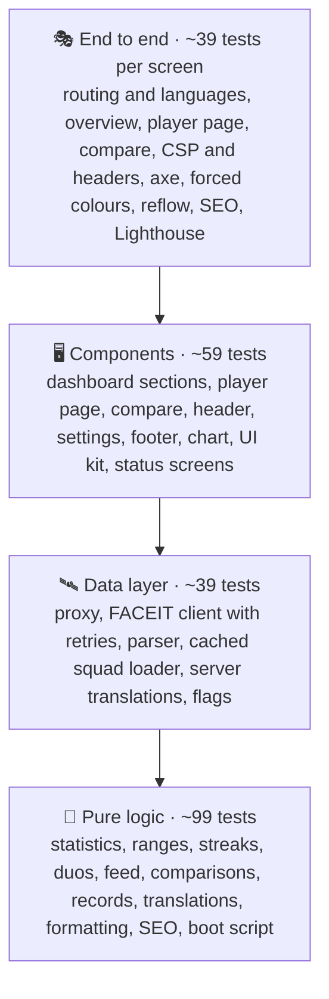
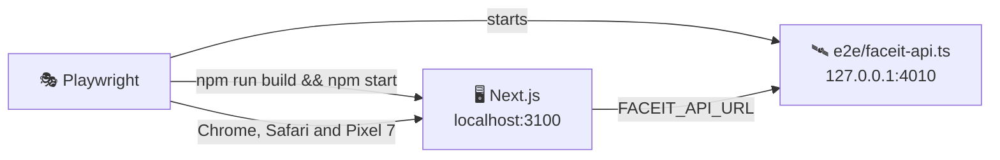

# 🧪 Testing

## 🧰 Stack

| Tool                            | Role                                                                  |
| ------------------------------- | --------------------------------------------------------------------- |
| ⚡ Vitest 5                     | Unit and component tests, configured in `vitest.config.ts`            |
| 🌐 jsdom                        | Browser-like environment for component tests                          |
| 🐙 Testing Library + user-event | Rendering components and simulating real interactions                 |
| 🧩 jest-dom                     | Readable DOM assertions such as `toBeChecked()`                       |
| 📊 `@vitest/coverage-v8`        | Coverage reports and thresholds                                       |
| 🎭 Playwright                   | End-to-end tests in Chromium and WebKit, on desktop and phone screens |
| ♿ axe-core                     | Accessibility checks inside the end-to-end tests                      |
| 🚦 Lighthouse                   | Performance, accessibility, best practices and SEO budget             |

## ▶️ Running tests

| Command                 | Mode                                                                          |
| ----------------------- | ----------------------------------------------------------------------------- |
| `npm test`              | 👁️ Unit tests in watch mode                                                   |
| `npm run test:run`      | 🧪 Unit tests, single run                                                     |
| `npm run test:coverage` | 📊 Unit tests with coverage and thresholds                                    |
| `npm run test:e2e`      | 🎭 Production build against the mock API, then Playwright, axe and Lighthouse |

The HTML coverage report is written to `coverage/index.html`, the Playwright report to `playwright-report/`; open the latter with `npx playwright show-report`.

> [!IMPORTANT]
> Install the browsers for the end-to-end tests once with `npx playwright install chromium webkit`, or `make browsers`.

## 🔺 Shape of the suite

Most behaviour is pinned down by fast tests of pure functions. Component tests render whole sections with a small sample squad and use them the way a visitor would. The end-to-end tests check what only a real browser and server can: redirects, status codes, hydration, the inline scripts, layout on a phone and accessibility of the finished pages.

## 📁 Where unit tests live

Tests sit next to the code they cover as `*.test.ts(x)`, and every component has its own file in its folder, for example `widgets/Footer/Footer.test.tsx`:

| Area           | Files                                                                             | Covers                                                                                                                                                                                |
| -------------- | --------------------------------------------------------------------------------- | ------------------------------------------------------------------------------------------------------------------------------------------------------------------------------------- |
| 🚦 Proxy       | `src/proxy.test.ts`                                                               | Redirects to the browser or saved language, lowercase languages, canonical nicknames, 404 rewrites                                                                                    |
| 🩺 Health      | `app/healthz/**/route.test.ts`, `app/.well-known/security.txt/route.test.ts`      | The health check, the age of the squad data for the monitor and `503` while it is unavailable, the security contact                                                                   |
| 🛰️ FACEIT      | `shared/api/faceit.test.ts`, `features/squad/api/parse.test.ts`, `loader.test.ts` | Headers, 404s, rejected keys, retries with backoff, parsing every response, missing configuration, dead avatars, outages during builds and in production                              |
| 🧮 Squad logic | `features/squad/model/*.test.ts`                                                  | Averages and ranks (ELO for every player), day and match ranges, streaks, lineups and duos, levels, maps, nicknames and configuration                                                 |
| 📊 Overview    | `features/dashboard/**/*.test.ts(x)`                                              | Every section, sorting the leaderboard with inactive players last, the feed, records, the map pool and its pale small samples, rankings, the range in the address                     |
| 👤 Player page | `features/player/**/*.test.ts(x)`                                                 | The per-range context, current form, the trend metric, filtering the match history, teammates, lifetime meters, map cards, empty states                                               |
| ⚔️ Compare     | `features/compare/**/*.test.ts(x)`                                                | Shared matches, the default pair, the pair from the address, swapping, the leader of each row                                                                                         |
| 🔎 SEO         | `features/seo/**/*.test.ts(x)`                                                    | Structured data, social metadata in every language, escaped JSON-LD                                                                                                                   |
| 📴 Offline     | `features/notifications/**/*.test.ts(x)`, `app/offline/[locale]/route.test.ts`    | The offline page in every language with a policy that allows only its own style and script, the notice, the worker registered in production once the page has loaded                  |
| 🧱 Widgets     | `widgets/Header/*.test.tsx`, `widgets/Footer/*.test.tsx`, `SettingsMenu`          | Navigation and the current page, the settings panel with the saved language, the theme and its browser colour and the effects, credits, the version and links that announce a new tab |
| 🌍 Languages   | `shared/i18n/*.test.ts`                                                           | Every key, plural form and placeholder in every language, number parameters, `Accept-Language`, loading catalogs on the server                                                        |
| 🧰 Shared      | `shared/lib/*.test.ts`, `shared/ui/**/*.test.tsx`                                 | Formatting, scales, the effects level, the public address and indexing, the inline boot script, the line chart, radio groups, avatars, notices, loading states                        |

## 🌐 Test environment

`src/test/setup.ts` prepares jsdom:

- 🧩 jest-dom matchers are registered.
- 🔗 `next/link` and `next/image` are replaced with plain `a` and `img` elements, and `usePathname()` reads the jsdom address, so components render without a Next.js router.
- 🧹 After every test the DOM is unmounted, the address is reset to `/en`, `localStorage` is cleared and the theme attribute is removed.

`vitest.config.ts` only collects `src/**/*.test.{ts,tsx}`, maps `@/` to `src/` and replaces `server-only` with an empty module, so server code can be tested directly.

Vitest runs with `pool: "vmThreads"`: one jsdom per worker, and every test file in a fresh context of its own, which is about twice as fast as a new process per file. Built-in browser objects such as `location` cannot be redefined in that pool: wrap a call such as `location.reload()` in a small module and spy on that module instead.

Unit tests run without React Compiler, the same in all four apps, so coverage counts the branches of the source rather than the cache checks the compiler adds. The production build, the end-to-end tests and Lighthouse cover the compiled code.

> [!NOTE]
> A few Next.js modules only work inside a Next.js build. Tests replace them with `vi.mock`: `next/cache` for `cacheLife` in the loader and the footer, and `next/root-params` for the language of the current route.

## 🛠️ Helpers

| Helper                               | File                    | Purpose                                                       |
| ------------------------------------ | ----------------------- | ------------------------------------------------------------- |
| `renderWithI18n(ui, locale)`         | `src/test/render.tsx`   | Renders a component inside `I18nProvider` in any language     |
| `i18nFor(locale)`, `CATALOG`         | `src/test/render.tsx`   | The translator and formatter of a language, and every catalog |
| `makeMatch()`, `makePlayer()`        | `src/test/factories.ts` | Consistent matches and players with unique ids                |
| `newestFirst()`                      | `src/test/factories.ts` | Sorts matches the way FACEIT returns them                     |
| `sampleSquad()`                      | `src/test/squad.ts`     | Three players with shared matches, lifetime data and an ace   |
| `PROFILE`, `matchItem()`, `LIFETIME` | `src/test/faceit.ts`    | Responses shaped like the real FACEIT Data API                |

## 🎭 End-to-end tests

`playwright.config.ts` starts two servers before the tests:

1. 🛰️ **The mock FACEIT API** (`e2e/faceit-api.ts`), a dependency-free Node server that answers the four endpoints the client uses. It generates the same squad on every run from a seeded random generator: four players (`anna`, `Bohdan`, `chris`, `dana`) with 55 to 76 matches each over the last two months, duos, trios, matches between squad members, an ace and a player without lifetime statistics. Match times are relative to the start of the server, so day ranges always have matches.
2. 🖥️ **A production build** of the app with `FACEIT_API_URL` pointing at the mock, served on port 3100.

> [!TIP]
> Locally both servers are reused when they are already running, so after the first run a repeated `npx playwright test e2e/accessibility.spec.ts` takes seconds. Start them yourself with the same environment as in `playwright.config.ts` to keep them between runs.

| Spec                       | Checks                                                                                                                                                                                                                                                                                                    |
| -------------------------- | --------------------------------------------------------------------------------------------------------------------------------------------------------------------------------------------------------------------------------------------------------------------------------------------------------- |
| 🧭 `routing.spec.ts`       | Redirect to the browser language (Ukrainian and Czech with its plurals), the saved language winning, lowercase languages, filters kept, nickname case fixed, translated 404s with status 404                                                                                                              |
| 🧑‍🤝‍🧑 `dashboard.spec.ts`     | The squad, day ranges in the address and after a reload, the theme and its browser colour from the settings, switching languages, the feed, player links                                                                                                                                                  |
| 👤 `player.spec.ts`        | Filtering the history, links to FACEIT and to the comparison, the empty lifetime state                                                                                                                                                                                                                    |
| ⚔️ `compare.spec.ts`       | Picking, swapping and reloading a pair, shared matches with match rooms                                                                                                                                                                                                                                   |
| ♿ `accessibility.spec.ts` | axe on seven pages in four languages, the dark theme, the full effects of Apple devices in both themes, the settings, the 404 page, the skip link with the keyboard, forced colours mode, no sideways scrolling at 320 px and no word cut off at 360 px in Dutch, Polish and Ukrainian, settings included |
| 🛡️ `security.spec.ts`      | No console errors or CSP violations while browsing three pages in three languages and opening the settings with the app's own flags, and every security header in place                                                                                                                                   |
| ✈️ `offline.spec.ts`       | The notice appears as a live region when the connection drops and goes away when it is back; a reload without a network shows the offline page in Ukrainian, which reloads itself once the connection is back                                                                                             |
| 🔎 `seo.spec.ts`           | Canonical and `hreflang` links, `og:locale`, JSON-LD, the sitemap and share images per language                                                                                                                                                                                                           |
| 📸 `visual.spec.ts`        | Screenshots of the missing page in both appearances and on a phone, compared on Linux only                                                                                                                                                                                                                |
| 🚦 `lighthouse.spec.ts`    | The Lighthouse budget below                                                                                                                                                                                                                                                                               |

`e2e/helpers.ts` holds what several specs share:

| Helper                | Purpose                                                                                                                                                                                                                                                   |
| --------------------- | --------------------------------------------------------------------------------------------------------------------------------------------------------------------------------------------------------------------------------------------------------- |
| `watchProblems(page)` | Collects console errors and CSP violations and returns a check that expects none; Safari's `Load failed` is allowed as often as requests were cancelled, and its access control errors for the app's own addresses, which only a cancelled request causes |
| `openSettings(page)`  | Opens the settings dialog                                                                                                                                                                                                                                 |
| `clippedText(page)`   | Texts that end in an ellipsis or are cut by their box, skipping hidden and transparent ones; the 360 px check expects none                                                                                                                                |
| `option(page, name)`  | The label of a radio option, which is what a visitor clicks                                                                                                                                                                                               |
| `MAC_USER_AGENT`      | A Mac `User-Agent` for the full effects                                                                                                                                                                                                                   |

CI runs the browsers as two parallel jobs, `npx playwright test --project=lighthouse` for Chromium on desktop and phone with the visual tests and Lighthouse, and `npx playwright test --project=webkit`; both commands work locally too.

Every spec except Lighthouse runs in **Desktop Chrome** and in **Desktop Safari** on WebKit, the engine of every browser on Apple devices, and every spec except SEO and Lighthouse also on a **Pixel 7** screen. In Safari, <kbd>Tab</kbd> skips links unless the setting is on, so the keyboard test presses <kbd>Option</kbd>+<kbd>Tab</kbd> there. Flags are served by the app's own `/flags/[code]` route, so the tests never depend on another site. The accessibility checks run with reduced motion, so transitions never catch axe halfway, and they also enable two axe rules that are off by default: `label-content-name-mismatch`, so a visible label always matches what voice control users say, and `target-size`, so every control is at least 24 × 24 px or far enough from its neighbours (WCAG 2.2, 2.5.8).

> [!NOTE]
> On Linux, as on the CI runners, the WebKit project browses with the user agent of Safari on Linux. WebKit there paints without a GPU, and the blurred glass and moving sky that Apple devices get would stall it until clicks time out, while Safari on Linux gets the lighter effects of every system but Apple's, as visitors with it do. The specs about Apple effects set a Mac user agent themselves, and a run on a Mac keeps the Mac agent everywhere.

### 📸 Visual tests

`e2e/visual.spec.ts` compares screenshots of the missing page in both appearances and on a phone with the files in `e2e/__screenshots__/`. The stats follow the clock of the mock API, so the other specs cover them instead. Fonts and anti-aliasing differ from one system to another, so screenshots are only taken and compared on the Linux runners of GitHub Actions: the `visual` project exists when `CI` or `VISUAL` is set, and the Chromium job of `e2e` runs it before Lighthouse.

1. 📸 After a change in the design, start the **Screenshots** workflow (`.github/workflows/screenshots.yml`) from the **Actions** tab.
2. 📥 Download its `screenshots` artifact and unpack it into `e2e/__screenshots__/`.
3. 📝 Commit the new files together with the change.

> [!NOTE]
> Until `e2e/__screenshots__/` exists, the visual tests load the pages without comparing anything (`ignoreSnapshots`). A screenshot may differ in at most 1% of its pixels, and the HTML report of a failed run shows the expected, the actual and the difference side by side.

### 🚦 Lighthouse budget

`lighthouse.spec.ts` runs after the other projects, one page at a time, in a fresh Chromium:

| Page                  | Form factor | Performance | Accessibility | Best practices | SEO | Page weight |
| --------------------- | ----------- | ----------: | ------------: | -------------: | --: | ----------: |
| 🧑‍🤝‍🧑 `/en`              | 🖥️ Desktop  |      ≥ 0.90 |             1 |              1 |   1 |    ≤ 425 KB |
| 🧑‍🤝‍🧑 `/en`              | 📱 Mobile   |      ≥ 0.80 |             1 |              1 |   1 |    ≤ 425 KB |
| 👤 `/uk/players/anna` | 🖥️ Desktop  |      ≥ 0.90 |             1 |              1 |   1 |    ≤ 440 KB |
| ⚔️ `/pl/compare`      | 🖥️ Desktop  |      ≥ 0.90 |             1 |              1 |   1 |    ≤ 485 KB |

Every audit of the accessibility category must pass as well, including the ones Lighthouse does not weigh into the score. Each run attaches the full Lighthouse HTML report to its test in the Playwright report, so a failed budget can be inspected in CI.

> [!NOTE]
> Locally the pages score 0.97 to 1 for performance and 1 everywhere else; the thresholds leave room for slower CI machines. The pages weigh about 385 to 445 KB, counting the shells Next.js prefetches for the visible links. Each page weight limit sits about 35 to 40 KB above what the page weighs today, the same rule in all four apps, so a heavier dependency or a bigger prefetch fails the build early. `/pl/compare` weighs the most because Polish needs the Latin Extended font file next to the Latin one. Inlining the CSS with `experimental.inlineCss` was measured too and made every page about 20 KB heavier, because the prefetched pages then carry the styles as well.

## 📐 Conventions

- 🎯 Query by role and accessible name, for example `getByRole("button", { name: /^K\/D/ })`. If an element is hard to find this way, it is hard to use with a screen reader too.
- 🖱️ Drive the UI with `userEvent`; use `fireEvent` only for things user-event cannot express, such as moving a range input. In Playwright, choose styled radio buttons through their label with `option(page, name)` from `e2e/helpers.ts`.
- 👀 Test behaviour, not implementation: assert on what a visitor sees, the address or stored values.
- 🌍 Assert on English texts by default and add a check in another language where wording or formatting differs.
- 🌐 Never call the real FACEIT API: stub `fetch` with `vi.stubGlobal` and typed `vi.fn<Fetch>()` mocks in unit tests, and use the mock server in end-to-end tests.
- ⏱️ Retries and backoff run on fake timers; `vi.runAllTimersAsync()` settles them instantly.
- 🔧 Environment variables are set with `vi.stubEnv` and restored automatically.

## 📊 Coverage

`npm run test:coverage` fails below these thresholds:

| Metric        | Threshold |
| ------------- | --------: |
| 📄 Statements |      96 % |
| 🔀 Branches   |      89 % |
| 🧩 Functions  |      96 % |
| 📏 Lines      |      97 % |

The suite currently covers about 98 % of statements, 90 % of branches, 98 % of functions and 98.6 % of lines. Each threshold sits about a point below the current coverage, the same rule in all four apps, so a change can only keep or raise it; raise them again when new tests add a point. Routes in `src/app`, the image generators in `src/features/seo/og` and the test helpers are excluded, because the end-to-end tests and the production build cover them. CI publishes a coverage summary and uploads the HTML coverage and Playwright reports.
